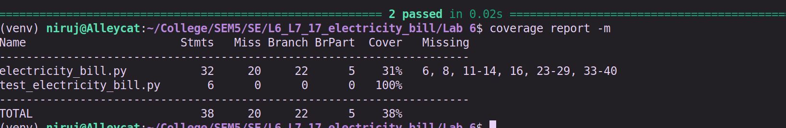
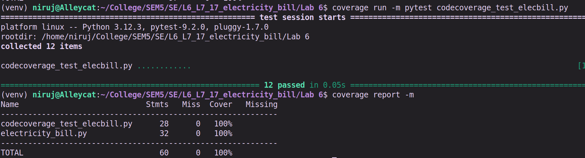
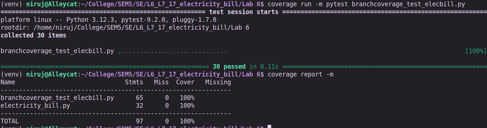

# L6_L7_17_electricity_bill — Electricity Bill

Lab 6: Code and Branch Coverage

## About

A small Python module that works out the electricity bill using unit slabs, adds late payment fees and calculates subsidies.

## Files

| File | Description |
|------|-------------|
| `electricity_bill.py` | The module under test |
| `test_electricity_bill.py` | Starter test file |

Refer to the lab handout for instructions.

## Before Updating:

## After Updating:

