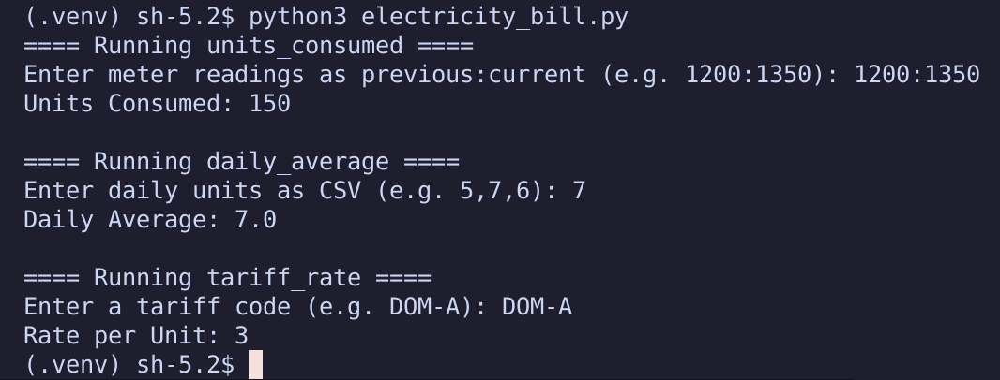
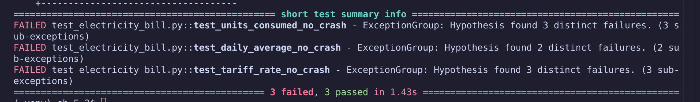
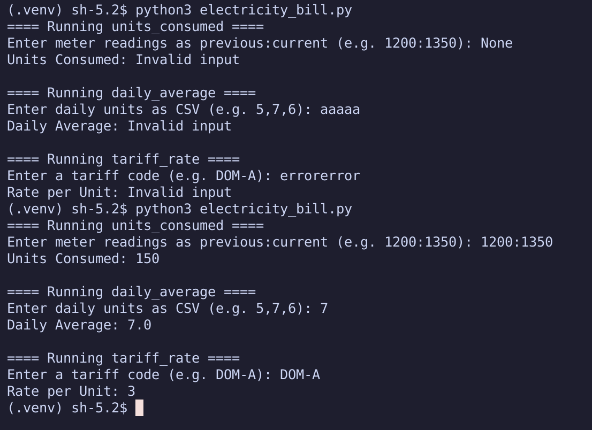
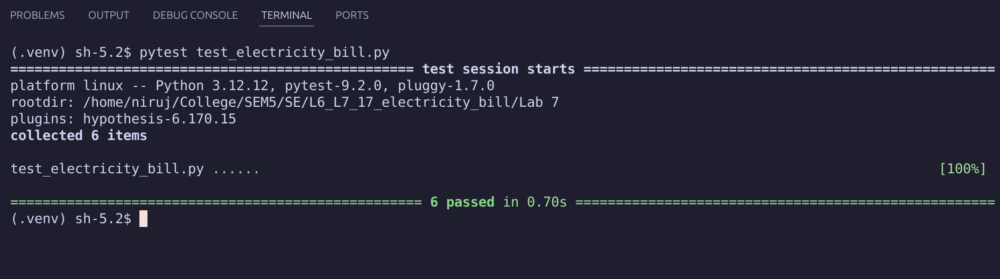

# L6_L7_17_electricity_bill — Electricity Bill

Lab 7: Fuzz Testing

## Files

| File | Description |
|------|-------------|
| `electricity_bill.py` | Buggy code to test and fix |
| `test_electricity_bill.py` | Fuzz test file to complete using Hypothesis |

Refer to the lab handout for instructions.

## Before Updating:

## After Updating:

